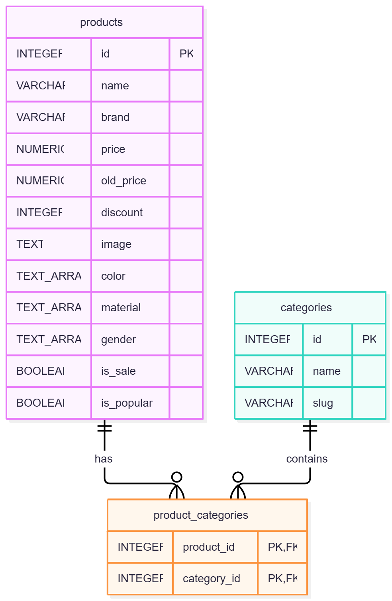

# vesta-project

## Структура базы данных

База данных проекта VESTA состоит из трёх связанных таблиц:
- `products` — товары;
- `categories` — категории;
- `product_categories` — связь товаров с категориями.

### ER-диаграмма

